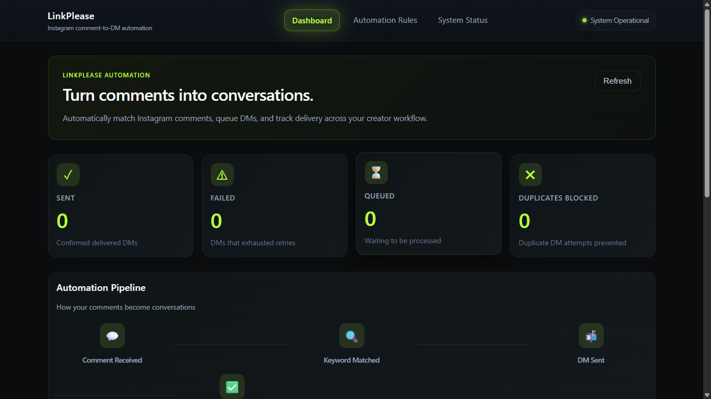
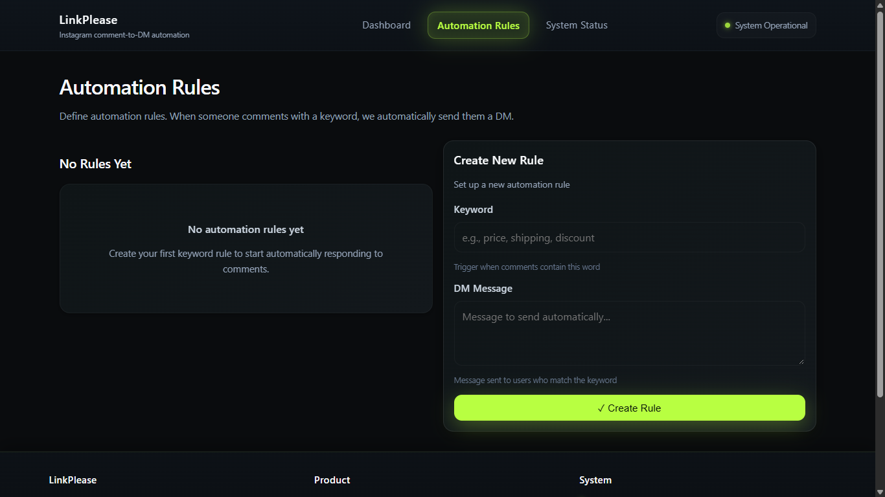
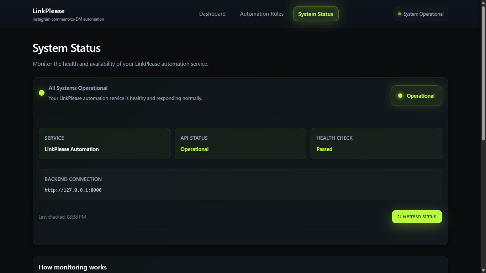
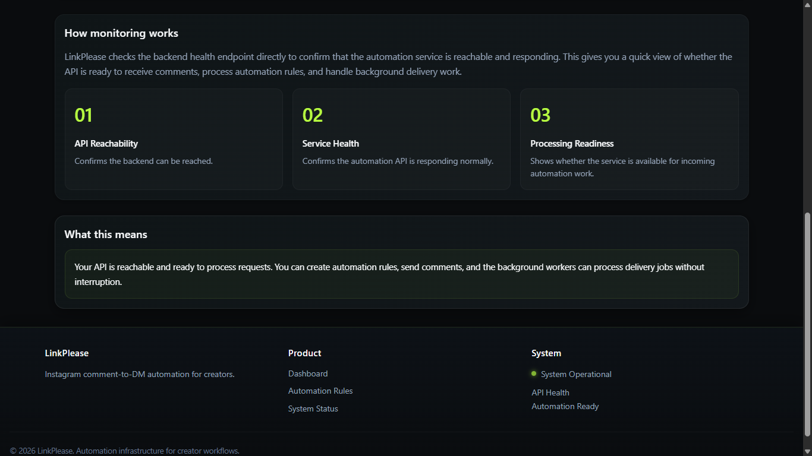
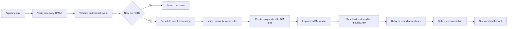

# HookRelay

<p align="center">
  <strong>Reliable webhook processing and comment-to-DM automation</strong><br/>
  Turning incoming events into durable, traceable messaging jobs.
</p>

<p align="center">
  <a href="https://github.com/HarshithhKumar/HookRelay/actions/workflows/ci.yml"></a>
  
  
  
  
  
  
</p>

HookRelay is a small event-driven application for accepting signed comment events, matching them against keyword rules, and turning matches into persistent outbound-message jobs. Its backend focuses on traceability and recovery: events, jobs, send attempts, duplicate blocks, and delivery state are stored in a relational database.

> **Integration boundary:** Outbound requests go to **PseudoGram**, a mock upstream API. This repository does not implement or claim a live Instagram integration. The screenshots below are from a local development run; their displayed status text and feature descriptions are not independent proof of external delivery or production health.

## Contents

- [Screenshots](#screenshots)
- [Stack](#stack)
- [Features](#features)
- [Architecture and event lifecycle](#architecture-and-event-lifecycle)
- [Data model and job states](#data-model-and-job-states)
- [API reference](#api-reference)
- [Configuration](#configuration)
- [Run locally](#run-locally)
- [Tests and CI](#tests-and-ci)
- [Limitations](#limitations)
- [Repository layout](#repository-layout)

## Screenshots

The screenshots show the frontend pages and controls as they appeared in a local development session.

### Dashboard



The dashboard requests counters from `/stats` and presents sent, failed, queued, and blocked-duplicate totals alongside a visual workflow overview. The pipeline graphic describes the intended lifecycle; it is not a per-event trace. Values in this local screenshot are sample state from that run.

### Automation rules



The rules page lists active rules and provides a form for a keyword and its DM message. The backend trims and lowercases the keyword, then matches it as a case-insensitive substring of comment text.

### System status



This page displays the result of a request to `/health`, the configured backend URL, and the time of the last check. The backend health route returns a basic service response; it does not check database connectivity, upstream API availability, or job delivery.

### Monitoring details



This capture shows the explanatory monitoring section beneath the status panel. Its reachability and service-health descriptions are UI guidance, not separate dependency checks.

## Stack

- **Backend API:** FastAPI with Pydantic request validation.
- **Persistence and migrations:** SQLAlchemy, PostgreSQL for Docker Compose, and Alembic. SQLite is the local default when `DATABASE_URL` is unset.
- **Frontend:** React 18, React Router, and Vite.
- **Local services:** Docker Compose for the backend and PostgreSQL.
- **Automated checks:** pytest for the backend and a Vite production build for the frontend.

## Features

### Signed webhook intake

- Verifies `X-PseudoGram-Signature` as an HMAC-SHA256 digest of the **exact raw request bytes**.
- Rejects missing, malformed, or invalid signatures before parsing or persistence.
- Validates the event envelope (`event_id`, `event_type`, `sent_at`, and `data`) and extracts comment, post, user, username, and text fields when supplied.
- Persists the original payload for traceability.
- Uses a unique event ID to acknowledge repeat deliveries as duplicates rather than inserting another event.

### Rule matching and durable work

- Stores keyword/message rules in the database; keywords are trimmed and normalized to lowercase.
- Matches active rules using case-insensitive substring matching. A comment can match more than one rule.
- Uses the stable provider `user_id` as the recipient identity; a username change does not create a different recipient.
- Creates a queued DM job for each matching rule and recipient, with a database uniqueness constraint allowing at most one job per rule/recipient pair.
- Records duplicate job attempts in `dm_job_duplicate_blocks`.
- Leaves events without a matching rule, recipient ID, or supported `comment.created` event type without a DM job; other event types are marked processed as no-op work.

### Worker and retry behavior

- The DM worker recovers pending events, claims at most one eligible job per run, and uses a lease timestamp so stale `sending` jobs can become eligible again.
- Persists outbound attempt timestamps and limits sends to 10 attempts in a rolling 60-second window.
- Sends a stable idempotency key in the form `linkplease-dm-job-{job_id}` for a logical job, including retries.
- Retries transport errors and transient server failures with exponential backoff. A `429` response uses `Retry-After` when available; otherwise the configured backoff applies.
- Marks an invalid client request (`400`) as failed. The maximum attempt count and base delay are configurable.
- Treats an upstream `202 Accepted` as acceptance, not delivery. It stores the returned DM ID and creates or updates a delivery record for later reconciliation.

### Delivery reconciliation and counters

- The reconciliation worker polls queued delivery records through PseudoGram.
- A reported `delivered` state marks the delivery and job delivered. A reported `failed` state marks the delivery failed and schedules the job for retry. Queued, unavailable, and unknown responses remain eligible for a later check.
- `/stats` reports delivered jobs as `sent`, permanently failed jobs as `failed`, queued/sending/accepted/retrying jobs as `queued`, and stored duplicate blocks as `duplicates_blocked`.

## Architecture and event lifecycle



The React/Vite frontend calls the FastAPI service. SQLAlchemy maps application state to PostgreSQL in the Docker Compose setup; a local SQLite URL is used when no `DATABASE_URL` is configured. Alembic migrations define the schema. The API process starts the DM and reconciliation loops unless `DISABLE_BACKGROUND_WORKERS` is enabled.

The webhook response acknowledges durable intake; it does not wait for a DM to be delivered. Processing can also recover unprocessed events from storage when the worker runs.

## Data model and job states

| Entity                | Responsibility                                                                                  |
| --------------------- | ----------------------------------------------------------------------------------------------- |
| `Rule`                | Active keyword and outbound message template.                                                   |
| `Event`               | Validated webhook fields, original payload, timestamps, and processing flag.                    |
| `DMJob`               | One logical outbound job, recipient, current state, attempt count, retry time, and provider ID. |
| `DMSendAttempt`       | Durable timestamp for a send attempt and rolling-window accounting.                             |
| `DMRateLimitLock`     | Singleton database row used while reserving a rate-limit slot.                                  |
| `DMJobDuplicateBlock` | A duplicate job attempt prevented by the rule/recipient uniqueness constraint.                  |
| `Delivery`            | Provider DM ID and status used by reconciliation.                                               |

DM jobs can move through `queued`, `sending`, `accepted`, `retrying`, `delivered`, `failed`, or `cancelled`. Delivery records use `queued`, `delivered`, or `failed`. `accepted` means the upstream API accepted a request; only reconciled `delivered` records contribute to the `sent` counter.

## API reference

| Method | Path               | Behavior                                                                                                                                                    |
| ------ | ------------------ | ----------------------------------------------------------------------------------------------------------------------------------------------------------- |
| `POST` | `/webhook`         | Verify and validate a signed event, persist it once, then schedule processing for a new event. Returns `{"status":"accepted"}` or `{"status":"duplicate"}`. |
| `POST` | `/rules`           | Create a rule. Returns `201` with `rule_id`, normalized `keyword`, and `dm_message`.                                                                        |
| `GET`  | `/rules`           | List active rules.                                                                                                                                          |
| `GET`  | `/rules/{rule_id}` | Retrieve a rule or return `404`.                                                                                                                            |
| `GET`  | `/stats`           | Return `sent`, `failed`, `queued`, and `duplicates_blocked` integer counters.                                                                               |
| `GET`  | `/health`          | Return basic service identity/status JSON; does not test database or upstream dependencies.                                                                 |

### Create a rule

```http
POST /rules
Content-Type: application/json
```

```json
{
  "keyword": "PRICE",
  "dm_message": "Thanks for your interest. Here is the price list."
}
```

The keyword is trimmed and stored in lowercase. The message is preserved as supplied, and blank keywords or messages are rejected with a validation response.

### Webhook event shape

The signed JSON body has an event envelope and a `data` object. User identity is read from `data.from.user_id`; optional fields are accepted when present.

```json
{
  "event_id": "evt_example_001",
  "event_type": "comment.created",
  "sent_at": "2026-08-10T09:14:22.481Z",
  "data": {
    "comment_id": "comment_123",
    "post_id": "post_456",
    "text": "PRICE please",
    "from": {
      "user_id": "user_789",
      "username": "example.user"
    }
  }
}
```

Sign the exact bytes sent in the request body and pass the digest in `X-PseudoGram-Signature` using the `sha256=<hex digest>` format. Re-serializing the JSON after signing changes the bytes and invalidates the signature.

## Configuration

Copy [`backend/.env.example`](backend/.env.example) as a reference. Set secrets through environment variables or an untracked `.env` file; do not commit real credentials.

| Variable                          | Default or purpose                                                                                                                                |
| --------------------------------- | ------------------------------------------------------------------------------------------------------------------------------------------------- |
| `APP_ENV`                         | `development` when unset.                                                                                                                         |
| `DATABASE_URL`                    | SQLAlchemy connection URL. If unset, the backend uses `backend/linkplease.db` (SQLite). Docker Compose supplies its PostgreSQL URL.               |
| `PSEUDOGRAM_API_KEY`              | Shared secret for webhook HMAC verification and the `X-API-Key` sent to PseudoGram. Required for signed webhook acceptance and outbound requests. |
| `PSEUDOGRAM_BASE_URL`             | `https://pseudogram-api.onrender.com` by default; base URL for the mock provider client.                                                          |
| `DM_WORKER_MAX_ATTEMPTS`          | `5`; maximum outbound attempts before a job is marked failed.                                                                                     |
| `DM_WORKER_RETRY_BASE_SECONDS`    | `30`; base used for exponential retry delay.                                                                                                      |
| `DM_WORKER_SENDING_LEASE_SECONDS` | `120`; age after which a `sending` job can be reclaimed.                                                                                          |
| `FRONTEND_URL`                    | Optional additional CORS origin. Local Vite origins on port `5173` are allowed by default.                                                        |
| `DISABLE_BACKGROUND_WORKERS`      | Set to `1`, `true`, or `yes` to prevent startup worker loops.                                                                                     |
| `VITE_API_BASE_URL`               | Frontend build-time API base URL; defaults to `http://127.0.0.1:8000`.                                                                            |

## Run locally

### Docker Compose

Requirements: Docker and Docker Compose. From the repository root, provide `PSEUDOGRAM_API_KEY` in the shell or root `.env` file, then start the services:

```bash
docker compose up --build -d
docker compose exec backend alembic upgrade head
```

The migration command applies the schema; the app does not create the production schema automatically. Local endpoints:

- Frontend: `http://localhost:5173` (run Vite separately; Docker Compose starts the backend and database only)
- API: `http://localhost:8000`
- Health: `http://localhost:8000/health`
- Interactive API docs: `http://localhost:8000/docs`

The backend service uses PostgreSQL in Compose. The root `.env` is used by Compose variable interpolation; `backend/.env` is loaded by the backend settings module when running the backend directly.

### Backend and frontend separately

Use Python 3.12 or newer and Node.js 22 for the versions used by CI. In PowerShell, from the repository root:

```powershell
cd backend
py -3.12 -m venv .venv
.\.venv\Scripts\Activate.ps1
python -m pip install -r requirements.txt
Copy-Item .env.example .env
```

Set `PSEUDOGRAM_API_KEY` in `backend/.env`. For local development without PostgreSQL, leave `DATABASE_URL` empty to use the default SQLite file. Apply migrations and start the API:

```powershell
alembic upgrade head
uvicorn app.main:app --reload --host 127.0.0.1 --port 8000
```

In another terminal, start the frontend:

```powershell
cd frontend
npm ci
npm run dev
```

Vite prints the local frontend URL, normally `http://localhost:5173`. To use another API address, create `frontend/.env.local` with `VITE_API_BASE_URL=http://127.0.0.1:8000` and restart Vite.

## Tests and CI

Run the backend tests from `backend/`:

```bash
pytest -q
```

The suite covers database constraints, webhook verification and persistence, rule APIs, event processing, worker retry/rate-limit behavior, and reconciliation. Most upstream HTTP behavior is exercised with test transports or controlled responses; the test suite does not verify a live Instagram integration or real PseudoGram delivery.

Build the frontend for production from `frontend/`:

```bash
npm ci
npm run build
```

GitHub Actions runs the backend tests on Python 3.12 and the frontend build on Node.js 22 for pushes and pull requests targeting `main`. See [`.github/workflows/ci.yml`](.github/workflows/ci.yml).

## Limitations

- PseudoGram is a mock upstream boundary; no live Instagram API integration is included.
- The DM and reconciliation loops run inside the FastAPI process. A separate queue and worker deployment are not part of this repository.
- `/health` reports basic application reachability, not a database, provider, or end-to-end readiness check. The monitoring screenshot reflects that endpoint and UI copy only.
- A provider acceptance response is not a delivery receipt. Delivery status depends on later reconciliation.
- Crash windows, network partitions, reconciliation delays, and concurrency edge cases are tracked in [`FAILURES.md`](FAILURES.md); the presence of retries or stable idempotency keys does not eliminate every distributed-systems failure mode.
- The API routes shown here do not include an application user-authentication layer; deploy behind appropriate access controls for any environment where that is required.

## Repository layout

```text
backend/
  app/
    api/             FastAPI route handlers
    models/          SQLAlchemy entities and state enums
    schemas/         Request and response validation
    security/        Webhook signature verification
    services/        Event, rule, worker, provider, and reconciliation logic
  alembic/           Database migration history
  tests/             Backend test suite
frontend/
  src/
    components/      Shared navigation and footer
    pages/           Dashboard, automation rules, and system status
docs/
  screenshots/       Supplied local application screenshots
.github/workflows/   CI configuration
docker-compose.yml   Local PostgreSQL and backend services
render.yaml          Deployment configuration template
FAILURES.md          Documented edge cases and mitigations
```

## Design notes

HookRelay favors durable database state and explicit processing states over a larger distributed architecture. The current in-process workers keep the project compact, while a dedicated queue/worker deployment and stronger operational telemetry are possible future directions. The mock-provider boundary is the intended place to add a real messaging adapter without presenting one as already integrated.

---

<p align="center">
  <strong>Built to explore dependable event-driven backend workflows.</strong>
</p>
