# HookRelay

<p align="center">
  <strong>Reliable webhook processing and comment-to-DM automation</strong><br/>
  Turning incoming events into durable, traceable messaging jobs.
</p>

<p align="center">
  <a href="https://github.com/HarshithhKumar/HookRelay/actions/workflows/ci.yml"></a>
  
  
  
  
</p>

HookRelay models a common backend challenge: receiving external events and turning them into outbound actions without losing work or accidentally processing the same event twice. It verifies webhook signatures, persists events, matches automation rules, and processes message jobs with deduplication, retries, rate limiting, and delivery reconciliation.

> **Integration note:** Outbound messaging currently uses **PseudoGram**, a mock upstream API. This repository does not claim a live Instagram integration.

## At a glance

- **Backend:** FastAPI, SQLAlchemy, Alembic
- **Persistence:** PostgreSQL
- **Dashboard:** React, Vite
- **Local environment:** Docker Compose
- **Quality checks:** pytest and frontend production build

## Workflow

```mermaid
flowchart LR
    A[Incoming comment event] --> B[Verify signature]
    B --> C[Persist and deduplicate]
    C --> D[Match active rules]
    D --> E[Create durable DM job]
    E --> F[Rate-limited worker]
    F --> G[PseudoGram API]
    G --> H[Retry or accept]
    H --> I[Reconcile delivery status]
    I --> J[Health and dashboard stats]
```



## Reliability features

| Concern | How HookRelay handles it |
|---|---|
| Replayed webhooks | Unique event IDs and duplicate detection |
| Duplicate outbound jobs | Database-enforced uniqueness by rule and recipient |
| Retry safety | Stable idempotency keys and persisted retry state |
| Temporary failures | Exponential backoff and retry handling for transient errors |
| Rate limits | Persisted send-attempt records and a rolling-window limit |
| Accepted but not delivered | Delivery records and status reconciliation |
| Restart recovery | Database-backed events, jobs, attempts, and delivery state |

The core data model includes `Rule`, `Event`, `DMJob`, `DMSendAttempt`, `Delivery`, and `DMJobDuplicateBlock`. Known edge cases and limitations are documented in `FAILURES.md`.

## Architecture

The React dashboard calls the FastAPI service. The backend stores workflow state in PostgreSQL and communicates with PseudoGram for mock outbound messaging. Worker and reconciliation loops currently run inside the FastAPI process; they are not yet deployed as separate worker services.

## Quick start

### Option 1: Docker Compose

Requirements: Docker and Docker Compose.

```bash
git clone https://github.com/HarshithhKumar/HookRelay.git
cd HookRelay
docker compose up --build
```

When the services are ready:

- API: [http://localhost:8000](http://localhost:8000)
- Health check: [http://localhost:8000/health](http://localhost:8000/health)
- API docs: [http://localhost:8000/docs](http://localhost:8000/docs)

Run backend tests in the container:

```bash
docker compose exec backend pytest -q
```

Apply database migrations:

```bash
docker compose exec backend alembic upgrade head
```

### Option 2: Run locally

Create and activate a virtual environment in `backend/`, then install the dependencies:

```bash
cd backend
python -m venv .venv
# Windows PowerShell
.venv\Scripts\Activate.ps1
# macOS / Linux: source .venv/bin/activate
pip install -r requirements.txt
```

Configure the required environment variables using `backend/.env.example` as a reference, then start the API from the backend directory:

```bash
uvicorn app.main:app --reload --host 127.0.0.1 --port 8000
```

In another terminal, start the dashboard:

```bash
cd frontend
npm install
npm run dev
```

Set `VITE_API_BASE_URL` to the backend URL if the frontend is not configured to use the local API by default.

## API overview

| Method | Endpoint | Purpose |
|---|---|---|
| `POST` | `/webhook` | Verify and accept a signed event |
| `POST` | `/rules` | Create an automation rule |
| `GET` | `/rules` | List active rules |
| `GET` | `/rules/{rule_id}` | Retrieve a rule |
| `GET` | `/stats` | Read queue and delivery counters |
| `GET` | `/health` | Check service health |

Webhook requests are verified with HMAC-SHA256 using the `X-PseudoGram-Signature` header before event processing. The stats endpoint reports `sent`, `failed`, `queued`, and `duplicates_blocked` counters.

## Configuration

Use environment variables or your deployment's secret manager. Never commit real credentials.

| Variable | Purpose |
|---|---|
| `DATABASE_URL` | Database connection string |
| `PSEUDOGRAM_BASE_URL` | Mock upstream API URL |
| `PSEUDOGRAM_API_KEY` | Shared secret for mock API requests and signature verification |
| `DM_WORKER_MAX_ATTEMPTS` | Maximum retry attempts |
| `DM_WORKER_RETRY_BASE_SECONDS` | Base retry backoff |
| `DM_WORKER_SENDING_LEASE_SECONDS` | Lease duration for in-progress sends |
| `FRONTEND_URL` | Optional allowed frontend origin |
| `DISABLE_BACKGROUND_WORKERS` | Disable in-process worker loops when configured |

## Tests and build

Backend tests:

```bash
cd backend
pytest -q
```

Frontend production build:

```bash
cd frontend
npm ci
npm run build
```

A GitHub Actions workflow runs automated checks on repository changes. For the current test and build configuration, see [the CI workflow](.github/workflows/ci.yml).

## Repository layout

```text
backend/
  app/             API, models, schemas, security, services
  alembic/         Database migrations
  tests/           Backend tests
frontend/
  src/             React dashboard
.github/workflows/ CI checks
docker-compose.yml Local services
render.yaml        Deployment configuration
FAILURES.md        Known edge cases and limitations
```

## Design trade-offs and next steps

HookRelay prioritizes traceable state and recovery over a large distributed architecture. Running workers inside the API process keeps the demo easier to deploy, but a separate worker service and a dedicated queue would be natural next steps for higher-throughput production use.

Other useful extensions include stronger operational telemetry, configurable rule matching, and a live provider adapter behind the existing mock integration boundary.

---

<p align="center">
  <strong>Built to explore dependable event-driven backend workflows.</strong>
</p>
